# PG Ease tenant app — mobile audit

Audited in a phone-width browser (Playwright + system Chrome) at **360×800** and **412×915**, with mocked resident data only. No production records were created, edited, or deleted.

Screenshots:

- Before: `docs/mobile-audit/before/`
- After: `docs/mobile-audit/after/`
- Machine-readable tap and overflow notes: `metrics.json` in each folder

Brand colour stays `#008080`. Wording, API calls, and payment rules are unchanged. Tenants still pay the PG owner (UPI intent, UTR/screenshot, cash handover, or the owner’s gateway). They do not pay PG Ease.

## What was wrong

The app already had a 430px column, a teal theme, and four bottom tabs. On a real phone that still read as a squeezed website:

- Bottom tabs were only Dashboard, PG Search, My PG, and Menu. Payments, transactions, complaints, guest pass, night out, food, notice board, notice period, documents, notifications, and saved properties were missing from the tab bar. Saved Properties had **no menu entry at all**.
- Desktop sidebar was also missing Guest Pass, Night Out, Transactions, Notifications, and Saved Properties.
- Sub-pages repeated a “Back” row under a header that had no back control, so toolbars (Refresh + Add Guest Log, New Complaint, New Night Out) were cramped.
- Several controls were under 44px tall: Pay Dues, Edit, copy/show password, call and WhatsApp, filter chips, close icons.
- Payments’ three summary cards truncated “Outstanding Due”. My PG put “Pay Dues (₹…)” in the same row as the deposit, so the action sat in a corner. Long addresses were cut with no wrap.
- Centered dialogs (edit profile, invite code, ratings) did not use the bottom edge. The rent sheet’s UPI / QR / cash switch scrolled away with the bill.
- Search treated a failed request as “No PGs Found”. Complaints and the notice board did the same.
- The manifest pointed at one favicon with an invalid combined size and `purpose`.

Horizontal filter and category chips still scroll on purpose. That is not page overflow (`documentElement.scrollWidth` stayed within the viewport on every screen).

## Routes, menus, and status

| Surface | What it contains | Problems found | Status |
| --- | --- | --- | --- |
| `/` Dashboard | Greeting, stay card, dues, KYC, quick actions, PG search | Pay Dues and “View Stay Details” under 44px; dues title and due chip collided; bell duplicated a missing app bar; quick actions were the only way to night out and the notice board | **Fixed** |
| `/` unlinked and guest | Unlinked notice, or explore-only home | Same chrome issues | **Fixed** |
| `/login` | Phone, WhatsApp/SMS, OTP, intent | Already a full-screen flow. OTP boxes are 16px+ so iOS does not zoom. Legal links stay inline in the sentence | **Fixed** (app-shell viewport and input size were already correct; confirmed on 360) |
| `/search` Find PG | Search, chips, filters sheet, cards | Chips and bookmark were small; a failed search looked like an empty city | **Fixed** — chips scroll, taps are 44px, load error has Try again |
| `/pg/:id` PG details | Gallery, save, share, call, map | Map link was a 16px text control | **Fixed** |
| `/saved` Saved Properties | Bookmark list, empty and signed-out states | Route existed but was not in any menu | **Fixed** — drawer, Menu, and desktop sidebar |
| `/my-pg` | Stay card, pay, agreements, inventory, services, staff, Wi-Fi, amenities, invite code | Pay button crowded the deposit row; address truncated; 4-column grid; Night Out and Notice Board missing; call targets were 32–36px | **Fixed** |
| `/payments` | Summary, bills, line items, UPI and bank/UTR entry points, ledger | “Outstanding…” truncated; line items could not wrap; history errors looked empty | **Fixed** — cards stack under 420px |
| `/payments/result` | Gateway return | Relied on the same header | **Fixed** |
| `/transactions` and `/payments/history` | Ledger | Back row plus small refresh; not in mobile nav | **Fixed** |
| `/complaints` | List, category chips, raise form with photo | Cramped toolbar; failed load looked empty; file input was `display:none` only | **Fixed** — label-owned file input |
| `/guests` and `/guest-entry` | Guest logs and night-out tab, add form | Back + Refresh + Add Guest Log on one row | **Fixed** |
| `/night-out` | Overnight leave form and logs | Small “New Night Out”; not in My PG or the menu | **Fixed** |
| `/food` and `/dining` | Week menu | Day chips scroll (intentional); refresh was a 26px icon; long PG name in the badge | **Fixed** |
| `/wifi` | SSID and password | Show/copy under 44px | **Fixed** |
| `/announcements` and `/notices` | Notice board | Not in the menu or My PG grid; errors looked like an empty board | **Fixed** |
| `/notice` and `/notice-period` | Vacate notice and checkout | Easy to miss from My PG | **Fixed** |
| `/documents` | KYC and agreements | DigiLocker and PDF links under 44px | **Fixed** |
| `/notifications` | Notice-based alerts | Clear control was 22px wide | **Fixed** |
| `/profile` and `/menu` | Profile, account, PG stay, support, edit / rate / refer / FAQ / settings / staff sheets | Did not list payments, guests, night out, food, notices, saved, or transactions. Camera control was 24px and covered the name | **Fixed** |
| `/wa/*` | WhatsApp deep link into pay, receipts, and other routes | Unchanged routing; still history-friendly | **Unchanged behaviour** |
| Rent sheet | Item picker, Instant UPI gateway, Direct UPI / QR + UTR/screenshot, cash handover | Mode switch sat under the bill. `upi://` was already a normal anchor | **Fixed** — full-screen sheet, modes pinned, anchor kept |
| Filter, edit profile, invite, rating, FAQ, settings | Modals | Centered cards on a phone | **Fixed** — bottom sheets under 1024px |
| Bottom tabs | Were 4 items | Payments and the rest of the product were a hunt | **Fixed** — Dashboard, PG Search, My PG, Payments, Menu, plus the services drawer |
| PWA manifest | `display`, theme, icons | One favicon, invalid `sizes` and `purpose` | **Fixed** — 192/512 any + maskable, `standalone`, `#008080` |

Loading skeletons sit with the existing “Loading…” lines on search, payments history, complaints, and the notice board. Empty copy is unchanged.

## Before and after (360×800)

| Screen | Before | After |
| --- | --- | --- |
| Dashboard | 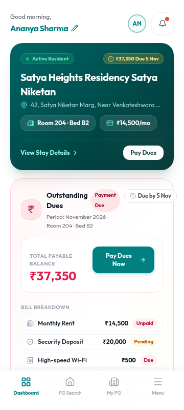 | 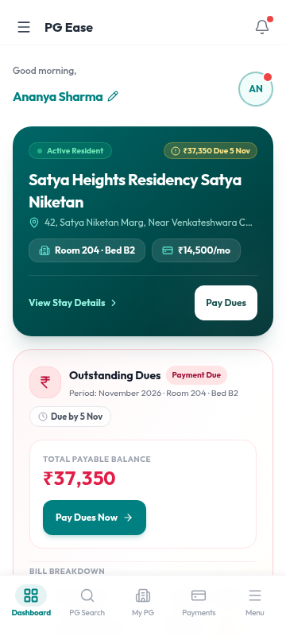 |
| Find PG | 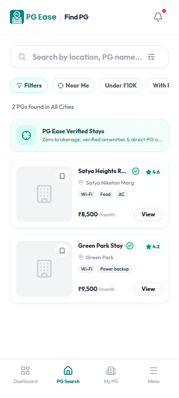 | 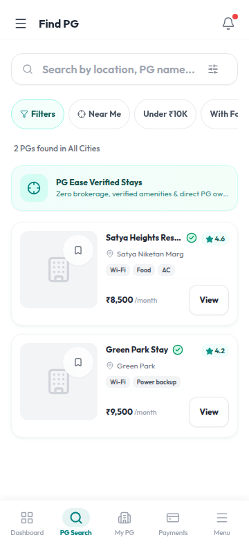 |
| My PG | 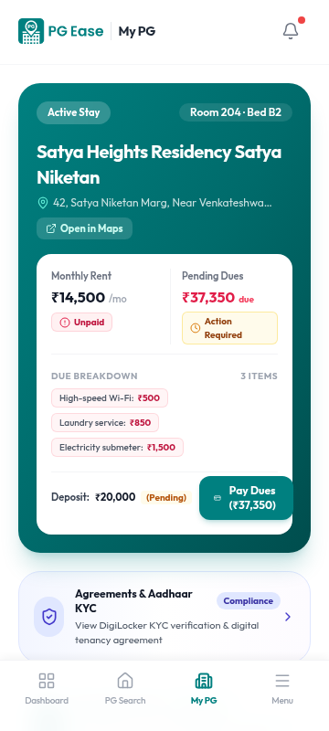 | 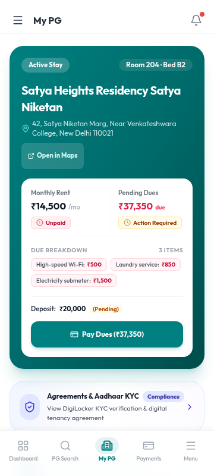 |
| Payments | 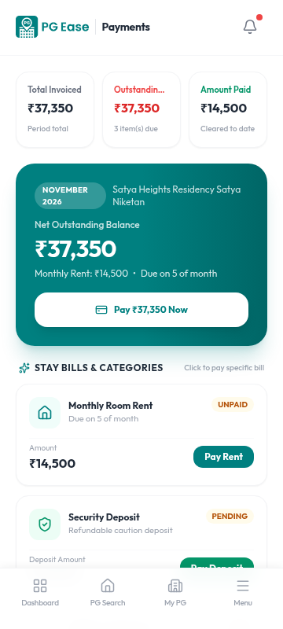 | 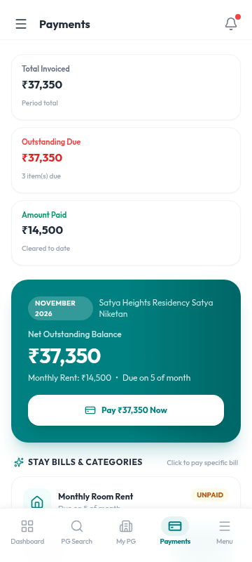 |
| Pay sheet (Direct UPI / QR) | 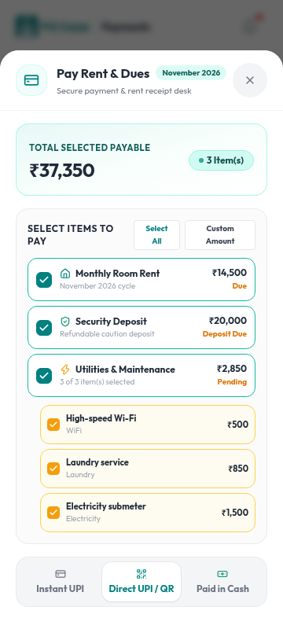 | 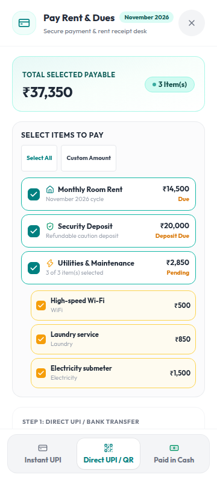 |
| Menu | 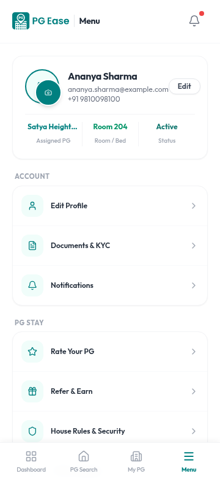 | 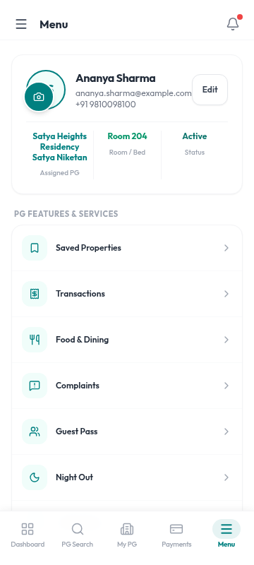 |
| All services | — | 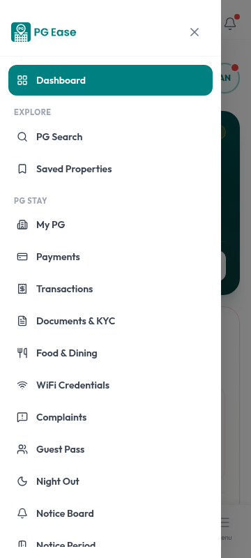 |
| Guest Pass | 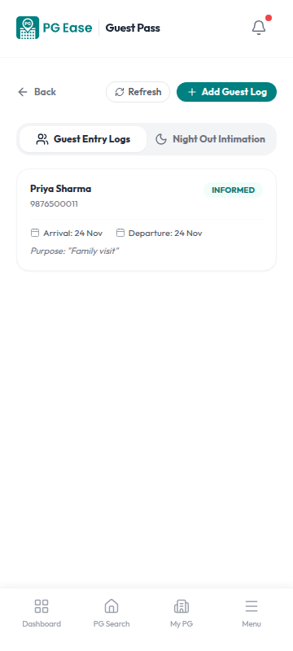 | 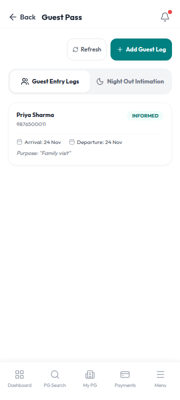 |
| Sign in | 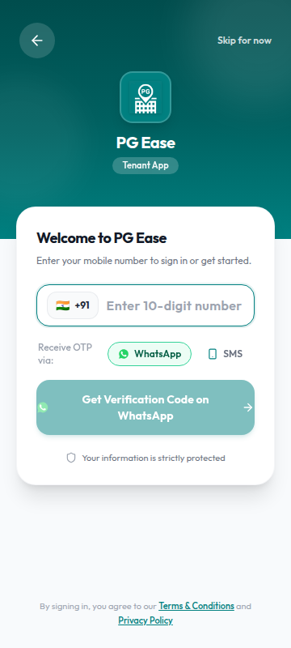 | 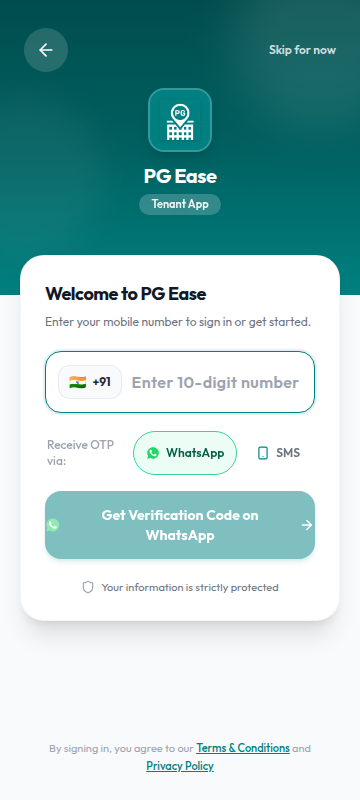 |

The same screens were captured at 412×915 (`412x915-*.png`). After the fix, both widths report **0** controls under 40px and **0** document-level horizontal overflow on every main screen.

## App shell

- `index.html` already had `viewport-fit=cover`. Inputs, selects, and textareas stay at 16px so iOS does not zoom.
- Manifest: `display: standalone`, `theme_color` / `background_color`, scope `/`, portrait, separate 192 and 512 icons plus maskable icons and an apple touch icon.
- Profile photo, complaint photo, UPI screenshot, and cash slip use a label-owned `input type="file" accept="image/*"` so the Android chooser can offer camera or gallery. `capture` is not forced, because a rent screenshot is often already in the gallery.
- `upi://pay?...` remains an `<a href>`. Gateway checkout still navigates to the hosted URL returned by the API.
- The app bar uses `navigate(-1)` when there is history, and the native bridge still does the same.

## For the founder

- Confirm the bottom-tab order (Dashboard, PG Search, My PG, Payments, Menu) matches the Android shell. Everything else is in the header menu and on the Menu tab.
- Screenshot data is a fictional resident (“Ananya Sharma”, Satya Heights). It is not a live tenancy.
- Desktop labels that already shipped (Explore PGs, My PG Stay, Rent & Payments, Food Menu, Wi-Fi Network, Profile & Settings) were kept. The missing destinations were added under those same names the phone screens already use.
